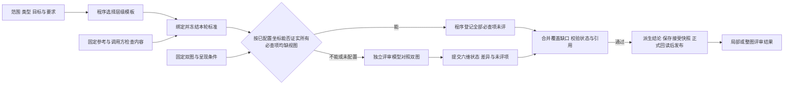

# 独立视觉评审 Agent 设计、架构与指标

- 日期: 2026-11-17.
- 状态: 首版工程实现已接通。已有[小样本真实模型校准及公开入口离线回放](independent-visual-review-implementation-20261117.md#16-元素与整图的小样本校准)。第 9 节记录 2026-11-20 的设计评审提案，当前接口见[评审工作流](../../src/shader_deep/workflows/review/README.md)，指标定义见[评审准则](../visual-review-rubric.md)。
- 开发分支: `TOoSad-deep/repo/visual-review`.
- 首版范围: 只比较参考与实际渲染图, 分局部和整图两种评审范围.
- 当前实现入口: [应用架构](../architecture.md)、[生成架构](../generation-architecture.md).
- 开发接续: [首版实施方案](independent-visual-review-implementation-20261117.md), 包含阶段依赖、文件分工、测试矩阵与完成清单.

## 1. 首版设计结论

使用一个独立视觉评审 Agent, 通过 `scope=local|scene` 指定评审范围. 局部必须进一步指定 `target_kind=feature|element`; 整图不填写 `target_kind`. 程序据此选择特征、元素或整图模板, 再绑定本次检查内容. 三种模板共用报告、工具、执行链和结论派生规则.

六个维度是统一分类, 不要求三个层级执行相同检查清单. 采用“共同判断语义 + 三种层级模板 + 每任务固定标准”: 模板规定重点与分级例子, 本轮绑定规定具体目标、必查内容、范围外内容与已有容差.

评审回答“在指定范围内, 渲染结果与参考相比有哪些可见差异”. 它不判断生成假设是否成立, 不解释 M/S 方法对错, 不修改 Shader 或自动调度下一步. 算法诊断、假设验证和反馈迭代留到后续任务.

当前评审通过独立输入捕获、原生角色和正式报告包执行. 入口见[评审工作流](../../src/shader_deep/workflows/review/README.md), 报告校验见[领域合同](../../src/shader_deep/domain/visual_review.py). 既有 review 任务类型继续保留在[任务记录](../../src/shader_deep/domain/tasks.py).

## 2. 两种评审范围

| 范围 | 评审对象 | 重点 | 结论边界 |
| --- | --- | --- | --- |
| `local` 局部 | 明确指定的特征或元素 | 该目标的轮廓、颜色、明暗、纹理、边缘及声明包含的局部关系 | 只对指定目标和可见范围有效 |
| `scene` 整图 | 完整渲染图 | 必要内容、布局、比例、整体色调、层次及跨元素关系 | 对本次完整图像与要求有效 |

局部评审不因范围外的内容未出现而扣分. 一个特征表现正确不代表整个元素正确, 多个局部表现正确也不代表整图正确. 整图必须独立检查, 不能简单平均局部结论.

例如“只评前圆的轮廓”时, 后圆是否存在不是本轮目标. 若目标是“前圆与后圆的透显效果”, 就必须提供相关区域; 缺少底层内容时应说明该项无法判断.

### 2.1 层级模板的确定性路由

| 输入组合 | 派生模板 | 主要任务 |
| --- | --- | --- |
| `scope=local`, `target_kind=feature` | `feature` | 指定可见表现, 如轮廓、亮带、渐变或透显 |
| `scope=local`, `target_kind=element` | `element` | 一个完整元素的必要特征和内部配合 |
| `scope=scene`, 不提供 `target_kind` | `scene` | 整图内容、构图和主要跨元素关系 |

缺少局部类型、未知枚举或整图携带局部类型均作为输入错误. 模板由程序选择, 不新增路由 Agent, 不允许评审模型改层级. 不再增加可独立填写的 `level` 或 `profile_id` 输入制造冲突组合; 实际 `profile_id` 与版本由程序登记. E/F 引用可辅助核对, 但没有五库 ID 的图片任务仍可显式声明类型.

## 3. 最小输入合同

以下说明首版输入含义, 具体类型为 `ReviewRequest`, 公开调用见[应用 README](../../README.md#独立视觉评审).

| 内容 | 要求 |
| --- | --- |
| `scope` | 明确为 `local` 或 `scene`, 由调用方固定 |
| `target_kind` | 局部必填 `feature` 或 `element`; 整图省略 |
| `reference_image` | 本次评审依据的参考图像 |
| `rendered_image` | 指定候选的实际渲染图, 不能以源码或路径文字替代图像 |
| `target` | 局部必填, 用文字说明特征或元素及评审范围; 整图明确评价完整图像 |
| `requirements` | 本次用户要求与需要特别关注的可见效果 |
| 检查内容绑定 | 按选定模板具体化六维的必查内容、排除内容及已有容差, 在评价候选前固定 |
| 区域与来源信息 | 使用裁剪时保存参考区域、候选区域及来源图像身份 |
| 实际呈现条件 | 保存尺寸、时间点、透明度背景和必要的比较说明 |

E/F 标识可用于关联目标, 但完整五库不作为首版必需输入. 若提供目标观察描述, 它只是辅助说明, 不能覆盖图像中可见的事实. 生成者自检、推理历史、Shader 正文和 M/S 方法正文不进入首版评审上下文.

每次评审使用独立会话，程序固定两张 PNG 的实际字节和内容摘要。调用方负责核对候选与 PNG 的对应关系。可选的候选 ID 和来源运行 ID 按调用方的声明保存到正式包，供回溯时查阅。

### 3.1 局部比较需要保证可比性

“评什么”和“看哪里”分开记录. 自由文本目标或 E/F ID 不能自动充当可靠裁剪坐标. 首版由调用方明确目标及区域, 不增加自动分割或配准 Agent.

- 同一画布下比较场景局部时, 使用对应区域, 保留足以理解目标的上下文. 不追着候选物体裁剪并居中, 以免掩盖位置或尺度错误.
- 若参考与候选使用不同区域或局部画布, 明确记录对应关系. 位置和绝对尺度只有在坐标关系可比较时才能评价.
- 孤立元素可以与参考中的对应外观比较, 但缺少背景、遮挡或相邻元素时, 透显、阴影和融合等依赖内容可能无法判断.
- 裁剪是从固定图像提取像素, 不能恢复被遮挡部分的真实外观. 不补画参考内容作为评审依据.

对必要项目缺少可比较材料时, 输出无法判断的范围和原因, 不直接判通过或失败. 范围外的背景变化不算问题; 范围内依赖背景的关系缺少证据则必须保留不确定性.

### 3.2 任务级标准绑定

首版由调用方基于模板、目标、参考材料与用户要求提供具体验收说明, 程序合并固定规则并校验结构, 形成 `BoundReviewCriteria`. 这个准备步骤不分析候选优劣, 也不新增生成标准的模型角色. 程序不声称能够自动从图像或任意要求正文推出完整验收标准.

绑定必须在评审模型收到候选图之前完成. 对既有生成结果开展实验时, 也不能为了候选已经呈现的效果反向降低标准. 内容不足以明确本轮范围时, 调用方需补全绑定, 不让评审边看候选边选择对自己有利的标准.

```text
BoundReviewCriteria
  程序字段: profile_id, profile_version, criteria_id, criteria_sha256
  任务事实: scope, target_kind(仅局部), target, 完整 requirements
  dimensions: 六项
    id
    required_checks: 本轮必查内容的文本列表
    excluded_checks: 范围外内容及理由的文本列表
    tolerances: 要求中已有容差及其来源, 无则为空
```

`required_checks` 表示该方面必须检查, 不表示任何可见偏差都自动为重大问题; 差异程度仍按统一严重性语义与层级锚点判断. 同一维度可只纳入部分内容, 例如 `shape` 必查亮带宽度与软边, 但排除支撑轮廓曲率. 没有必查内容的维度必须记录排除理由, 不隐式消失.

用户明确要求优先于模板默认值. 将任务从特征扩大到元素或整图, 不能自动放宽仍适用的明确要求; 暂未纳入某个局部任务的要求应说明范围, 不能据局部结果宣称完整目标满足. 容差没有来源时不生成任意百分比或数值阈值.

绑定保存实际内容及摘要, 不仅保存模板文件名. 本轮绑定、规则版本和图像版本共同决定报告解释范围. 更换目标、容差或排除项应形成新任务绑定, 旧报告保持原义. 范围内证据不足记录必要未评项; 若标准冲突必须通过改变绑定才能解决, 使用 `stop_review` 说明原因, 由调用方建立新绑定后重新评审, 不发布违反当前合同的报告.

## 4. 输出合同与指标责任

| 字段 | 内容 |
| --- | --- |
| 范围、目标与标准身份 | 由程序绑定输入和 `BoundReviewCriteria`, 模型不能改写 |
| `dimensions` | 固定六个视觉分类, 按本次绑定检查内容并记录状态、依据和引用 |
| `summary` | 在本次范围内的总体视觉判断 |
| `issues` | 可见差异列表: 位置、参考表现、候选表现、影响程度与理由 |
| `unassessed` | 范围内必要但未能判断的内容、所属指标与原因 |
| `limitations` | 不影响本次必要检查的限制, 如只覆盖当前时间点 |
| `verdict` | 程序从合法问题和未评项派生, 不由模型另行选择 |

六项短状态区分“已看且匹配”“未能看清”和“范围外”. 有必查内容的维度不能提交 `not_applicable`; 没有必查内容的维度保留该状态及绑定中的排除理由. 不按 E/F/R 再展开全量打分表, 不增加总分. 具体指标、等级和逻辑约束以[评审准则](../visual-review-rubric.md)为唯一详细定义.

每条问题只描述观察到的差异及影响. 例如“右侧亮边比参考宽, 导致轮廓显得更厚”, 不输出“某个反射假设不成立”或“必须换用某算法”. 首版不增加原因假设、机制置信度或修改代码建议等字段.

问题列表允许为空, 不要求固定条数. 同一个差异不重复登记, 不把一条问题拆成多个条目凑数量. 位置用清楚的区域说明即可, 不把模型估计坐标当作像素级测量.

### 4.1 总体结论

存在重大问题时派生 `needs_revision`; 没有重大问题但有必要未评项时派生 `inconclusive`; 其余合法报告为 `no_major_issue_observed`. 状态分级、混合已知/未知情况与完整性规则见[准则第 3–5 节](../visual-review-rubric.md#3-每项指标怎样分级).

程序派生避免总结与条目相互矛盾, 不能证明模型的视觉判断正确. 例如已确认重大问题时, 其他未评项仍保留, 但不会把已知问题改成不确定.

局部的 `no_major_issue_observed` 只对该局部有效. 它不自动表示元素全部通过、整图通过、方法可行或用户验收完成.

### 4.2 模型提交与正式报告

`ReviewSubmission` 保存模型判断, `ReviewReport` 由程序加上固定元数据与派生结论后形成. 下列为简化的字段关系, 完整类型见[领域合同](../../src/shader_deep/domain/visual_review.py)和[报告存储](../../src/shader_deep/infrastructure/storage/review_package.py).

```text
ReviewSubmission
  summary: 文本
  dimensions: 6 项 { id, status, rationale, issue_ids, unassessed_ids }
  issues: 列表 { id, dimension, region, reference_observation,
                 rendered_observation, severity, impact }
  unassessed: 列表 { id, dimension, subject, reason }
  limitations: 文本列表

ReviewReport
  程序元数据: review_id, scope, target_kind(仅局部), target,
              候选与输入身份, 实际呈现条件, 实际模型, 调用及费用记录
  criteria: 固定的 BoundReviewCriteria, 含实际模板与规则版本
  submission: 已接受的 ReviewSubmission
  verdict: 按指标准则派生
```

`rationale` 解释本项核对结果或绑定中的不适用原因. `issue_ids` 与 `unassessed_ids` 可以为空; 项目 ID 只在本报告中有效. 输入身份、scope 和标准绑定均由程序固定, 不让模型重填. 预算耗尽或执行失败的运行记录可以没有正式 `ReviewReport`, 不能填入默认视觉结论.

## 5. 简化后的运行架构

下图展示首版评审执行流程.



`feature`、`element` 和 `scene` 模板共用模型装配、输入捕获、报告合同、工具和预算. 路由选择模板, 绑定具体化本轮检查内容, 评审执行已固定的标准. 不建立三套执行框架.

首版模块均相对于 `src/shader_deep/`.

| 位置 | 职责 |
| --- | --- |
| `domain/visual_review.py` | 合法类型组合、标准绑定与报告的结构校验, 状态一致性与结论派生 |
| `agents/review/` | 角色、专用上下文和受限提交工具 |
| `workflows/review/` | 按类型选择模板、绑定标准、输入固定、预算、终态与交付 |
| `infrastructure/storage/review_package.py` | 捕获输入、保存来源与发布回读; 复杂后再分文件 |
| `resources/skills/visual-review/` | 共同主规则与 `profiles/feature.md`、`profiles/element.md`、`profiles/scene.md` 三种模板, 装配选中的模板 |

沿用 `create_deep_agent` 和既有模型、候选及图片基础能力. 新建评审上下文, 不直接复用携带源码和历史结果的[生成上下文](../../src/shader_deep/agents/generation/context.py). `domain/` 保持无 IO 和模型框架依赖. 详细报告只维护一份正文, 现有 `ResultRecord` 可登记候选引用与可派生摘要.

工具为 `submit_review(report)` 与 `stop_review(reason)`. 模型可见工具和实际执行白名单同步约束. 合同错误允许在预算内修正, 默认最多 3 次逻辑模型调用, 传输重试单列.

模型按绑定识别图像现象、材料是否足够及差异影响. 程序负责图像身份、模板选择、标准冻结、六项完整性、条目引用和结论派生. 程序能拒绝必查维度被标为不适用, 不能证明自由文本检查内容已被完整理解, 这一点仍需人工校准. 不为评审增加第二个评分或路由 Agent.

指定 PNG 缺失、损坏或裁剪区域越界时，程序在调用模型前报错。图像能否支持本次比较，仍由评审者判断。程序接受合法提交后结束模型会话，发布时回读报告并核对包内图像、固定标准和输入摘要，核对通过后才登记交付完成。已接受的报告在终态后不可改写。

运行状态由 `ReviewOutcome` 保存. `completed` 表示报告交付完成, `blocked` 表示预算耗尽或无法形成报告, `failed` 表示执行错误. 合法的 `inconclusive` 报告也可以正常交付, 视觉结论通过独立字段表达.

## 6. 指标与校准入口

[局部与整图评审准则](../visual-review-rubric.md)集中维护共同指标语义、三种层级模板、绑定后的适用性、重大/轻微锚点及汇总规则, 避免运行架构与指标文档各维护一套定义.

指标分为两层: 六个视觉维度评价当前候选; 精确率、重大问题召回率、错误放行、误拒、无法判断与范围遵守评价评审自身. 不引入假设成立分数、加权总分或未经校准的自动验收阈值.

人工校准按 `feature`、`element`、`scene` 模板分组, 标注使用相同绑定标准. 模板或要求改变后不能把两次结论直接解释为候选进步. 首批覆盖目标缺失、范围外差异、局部上下文不足、布局错误、平滑参考中的新增噪点与同图对照. 规则开发与评估样例按参考图分开, 重复运行只用于稳定性检查.

## 7. 实施顺序与交付状态

开发依次完成合同与基线、领域规则与模板、输入存储、原生角色与会话、API/CLI 与打包、分层人工校准. 文件责任、检查范围和进度统一记录在[实施方案](independent-visual-review-implementation-20261117.md), 本文保持业务架构的主要说明位置.

2026-11-18 已完成领域合同、三种模板、输入存储、独立角色、工作流和 API/CLI 的工程接线. 当前验证记录与待校准范围统一记录在[实施方案第 10 节](independent-visual-review-implementation-20261117.md#10-2026-11-18-工程实施记录).

## 8. 当前源码依据

- [任务与结果记录](../../src/shader_deep/domain/tasks.py)、[候选引用校验](../../src/shader_deep/domain/blackboard.py): 既有评审类型预留与固定候选引用.
- [规划角色](../../src/shader_deep/agents/planning/README.md): 原生角色、固定材料与工具白名单模式.
- [生成结束工具](../../src/shader_deep/agents/generation/tools/finish.py): 当前自检不等同于独立视觉评审.
- [文件存储](../../src/shader_deep/infrastructure/storage/README.md): 固定输入字节、发布和回读约定.

## 9. 2026-11-20 评审意见与下一版提案

本节保留设计取舍。显式启用 `visual_review_v2` 后，首个增量已实现必查项 ID、程序锁定、逐项登记、漏项反馈和已答保护。它沿用三种视觉结论，正式包可从答案重新生成六维报告。下面的范围授权、实质重评、下游摘要和恢复发布仍是提案。[运行合同](../../src/shader_deep/workflows/review/README.md)

### 9.1 调用方定范围，程序固定已知事实

- **谁有权排除。** 当前调用方自行声明六维的必查项与排除项。若候选由上游生成 Agent 提供，建议由独立的任务创建方根据原始要求和层级模板，在看候选前冻结必查清单及其来源。生成方可在冻结前建议加查或补充取证区域，由任务创建方确认。冻结后改变范围须建立新绑定，删减或放宽原要求还需原任务所有方同意。基线落实到具体目标。只要求亮带宽度时可以排除背景颜色，整图明确要求的前后遮挡则始终保留。
- **程序可以知道什么。** 当前覆盖预检使用调用方声明的 1:1 坐标映射，检验两侧窗口是否包含某个必查矩形。坐标覆盖完整后，过曝、语义遮挡和目标错位仍需看图；指定 PNG 缺失或损坏则属于输入错误。详见[当前覆盖规则](../../src/shader_deep/imaging/review_evidence.py)。
- **按检查项锁定。** 建议给每条必查项稳定 ID。程序回填预先排除的维度，并对坐标已证实缺图的检查项登记未评及原因。模型只接收待回答的检查项，逐项提交可见判断或未评原因。一个检查项只能提交一次，遗漏、越界或覆盖已锁事实均应拒绝。程序最后汇总成原有六维报告。外缘缺图时，齿盘中央仍可独立发现真缺陷。
- **哪些情况需要弃权。** 在可信的完整视图里，应有的孔被填平，属于可见差异。缺少看到孔所需的区域或对比条件，才把这一项记为未评。这样能防止“登记未评即不会被误放行”被误读为“模型绝不会漏掉必查项”。

### 9.2 下游一次读到该修什么、还需补什么

当前正式报告已经同时保存 `submission.issues` 和 `submission.unassessed`，重大问题只决定主结论的优先级。精简 CLI 输出只含状态、结论、目录和诊断。建议向调用方提供同一处派生摘要：

| 摘要内容 | 来源与用法 |
| --- | --- |
| `minor_issue_count` 和 `has_minor_issues` | 对去重后的轻微问题 ID 计数，布尔量由数量大于零派生。同一问题被多个维度引用只计一次。 |
| 需修正的问题 | 指向原报告的重大问题 ID，保留其位置、两侧观察与目标影响。轻微问题仍可通过原清单查阅。 |
| 仍待补证的检查项 | 指向原未评项 ID，一并展示检查内容、已有原因和能解除不确定性的材料。存在重大问题时也返回这一组。 |

严重性取决于是否破坏本轮必要目标。多处小偏差确实共同破坏整体表现时，须给出一条说明共同影响的重大问题，并去除重复计数。数量或跨维分布可作为复核提示，自动升级阈值需要独立校准。六维的重大与轻微成对例子已见[准则第 3 节](../visual-review-rubric.md#31-重大与轻微的锚点)。当前运行时的分级说明来自共同规则和所选层级模板。建议将适用维度的成对例子、用户明确容差和规则版本一起冻结，比较同一目标的多个候选时沿用相同标准。

### 9.3 校验退回后允许改变什么

默认最多三次逻辑调用，首轮之后最多还有两次。临时传输故障另有重试预算。V1 纠错时可重新提交整份报告。一次无网络模拟提交中，首稿已记录重大缺孔，仅将一个已排除维度错填为匹配。收到该维度的校验错误后，第二稿删除了缺孔问题，正式结论变为“未发现重大问题”。V2 将已登记的单项答案固定，补答其他项时保留原判断；如需推翻已登记的观察，当前须停止并重新发起评审。真实模型的误判频率有待校准。

| 退回原因 | 建议的修复边界 |
| --- | --- |
| 格式或可唯一还原的引用错误 | 返回错误位置，只修该字段及直接依赖的引用。保留已合法、无关的观察、严重度和未评项。引用歧义需要澄清。 |
| 观察与严重性、明确的测量关系或证据互相矛盾 | 显式重评受影响的检查项，允许纠正实质判断，记录原判断、新判断和依据。依赖项随之重新校验。 |

沿用现有逻辑调用上限。诊断记录轮号、错误类型和位置，以及检查项、问题和未评项的增删或降级。无合法提交时记录草稿变化；只有两份有效且采用同一固定输入和标准的结论才可比较视觉结论漂移。

### 9.4 受阻与发布失败后的恢复

`blocked` 运行已经留有固定输入、标准、停止原因、调用预算和拒绝次数。建议额外保存最后一次被拒的结构化提交及错误位置，按容量限制保存，避免重复写入图片载荷。模型直接停止或只回复文本时，应能记录“没有被拒提交”。[当前会话记录](../../src/shader_deep/workflows/review/session.py)

发布失败后已有 `results/accepted.json`。建议提供仅恢复发布的入口：从原运行的固定输入、规则、接受快照和执行元数据恢复，校验接受时绑定的输入、标准与提交摘要，再走同一发布与正式回读流程。重复或并发执行时，同身份的有效报告直接复用，缺失的运行索引可补写；目标已存在但内容冲突则报错并保留原件。验收时模拟“接受后发布失败”及“报告已发布但运行索引写入失败”，两种恢复路径的模型调用增量均应为零。历史运行缺少可核实的接受身份时，应明确指出恢复依据不足。[现有发布与回读](../../src/shader_deep/infrastructure/storage/review_package.py)

### 9.5 双图身份与验证样例

当前每张图前已有参考或候选的文本标签。已有磨砂圆实验比较过并排布局和采样框，局部明暗方向仍有误读；该实验未测到角色互换的发生率。[盲评与布局实验](independent-visual-review-implementation-20261117.md#14-磨砂叠圆特征盲评)

建议在独立样本上比较现有标记与“图外角色栏 + 左参考右候选”的派生视图。标记放在有效图像之外，保留两张原 PNG 的像素、坐标和身份；测量始终取原图。用同图对照检查标记是否制造了假差异，用交换两张图并同步更新角色的配对样本检查差异方向能否随角色反转。分别统计角色错认与看对角色却看错明暗的次数。

| 建议的验收用例 | 预期行为 |
| --- | --- |
| 仅评亮带宽度，上游试图删除宽度要求或增加无关背景检查 | 删除必查项需要新的授权绑定；沿用原绑定时，背景差异不进入结论。加查另有明确记录。 |
| 齿盘中心孔可见地被填平，外缘超出采集窗口 | 主结论为 `needs_revision`；调用方一次拿到缺孔问题和补拍外缘的原因。 |
| 三处轻微色差，其中一处跨两维引用 | 摘要计三条轻微问题；若缺少破坏必要目标的证据，继续保留轻微等级。 |
| 首稿有重大缺孔，仅排除维度填错状态 | 局部纠错保留缺孔。若要推翻此观察，进入带理由的实质重评。 |
