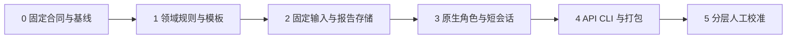

# 独立视觉评审 Agent 首版实施方案

- 日期: 2026-11-17.
- 分支: `TOoSad-deep/repo/visual-review`.
- 2026-11-18 已完成首版工程接线、一次基于测量证据的特征修订，以及六组元素和整图校准。工程证据见第 10–13 节，真实模型结果见第 14–16 节。
- 设计依据: [架构与合同](independent-visual-review-design-20261117.md)、[评审指标准则](../visual-review-rubric.md).
- 文档分工: 架构稿定义职责与合同; 指标准则定义视觉判断; 本文只定义开发拆分、接入选择、依赖、验收和实施记录.

## 1. 首版交付目标

调用方显式提供参考 PNG、渲染 PNG 和本次任务说明, 系统选择特征/元素/整图模板, 在评价候选前冻结检查标准, 运行一个独立评审 Agent, 发布可正式回读的报告包.


首版固定以下范围:

- 一个 Agent, 两类 scope, 三种确定性选择的模板. `local` 必须提供 `feature` 或 `element`; `scene` 不填写局部类型.
- 只评可见渲染结果. 不接入假设成立性、代码诊断、自动修订、重新规划、自动停止或网页交互.
- 六维分类、五种状态和结论规则直接落实既有准则. 不增加加权总分、额外指标依赖或新的模型 ID 默认值.
- 只开放 `submit_review` 和 `stop_review`. 不搬入完整草稿编辑机制, 不开放通用文件操作或任务派发.
- 先支持显式图片文件入口. 本轮不恢复生成会话, 不新增遍历旧运行的候选导入器.

完成情况分开记录: 工程链路可用、真实服务请求成功、评审质量校准、用户接受. 任一前置检查通过均不代表后续阶段已经完成.

## 2. 已有能力与接入选择

| 能力 | 当前依据 | 本轮使用方式 |
| --- | --- | --- |
| 模型配置、传输适配和工具原文校验 | [模型适配说明](../../src/shader_deep/infrastructure/llm/README.md) | 复用 `build_model`、传输配置与响应校验, 不另建客户端 |
| 原生角色和固定材料注入 | [规划角色](../../src/shader_deep/agents/planning/native.py) | 借鉴实际请求注入和双侧工具白名单; 新建评审专用上下文 |
| 单次会话预算、接受与发布 | [规划工作流](../../src/shader_deep/workflows/planning/entry.py)、[PlanningSession](../../src/shader_deep/workflows/planning/session.py) | 复用状态分工, 不复制草稿、分页回读与五工具合同 |
| 运行目录与单文件快照 | [artifacts.py](../../src/shader_deep/infrastructure/storage/artifacts.py)、[snapshots.py](../../src/shader_deep/infrastructure/storage/snapshots.py) | 直接复用目录和快照写入能力 |
| 图片与正式包捕获 | [planning_inputs.py](../../src/shader_deep/infrastructure/storage/planning_inputs.py)、[存储说明](../../src/shader_deep/infrastructure/storage/README.md) | 借鉴严格解析、路径、哈希和发布规则; 不把规划专用类型伪装成评审输入 |
| PNG data URL | [messages.py](../../src/shader_deep/infrastructure/llm/messages.py) | 编码捕获后的图像; 该 helper 不做解码校验, 预检须单独完成 |
| review 类型预留 | [tasks.py](../../src/shader_deep/domain/tasks.py) | 保留既有兼容性; 首版独立运行目录交付, 不回写生成者的候选选择 |

当前 `run.json` 是业务快照, 没有通用的会话恢复入口. [scene_inputs.py](../../src/shader_deep/infrastructure/storage/scene_inputs.py) 的来源读取限制为旧报告、已完成且已选择的候选, 不适合直接充当通用评审读取器. 显式两图入口避免把这些限制带入首版.

调用方可以选择已有运行中任何有实际预览的候选文件, 不要求它已被生成者选中. 若提供候选 ID、来源运行或时间等信息, 按声明保存, 不声称验证了完整历史生成过程. 图片的实际字节身份由本轮捕获确定.

## 3. 先固定的接口与实现约定

### 3.1 新入口草案

```python
# 拟议新增接口, 尚未实现.
run_review(reference_path, rendered_path, request, *, options=None)
read_review_package(directory)
```

`request` 为严格校验的 `ReviewRequest`, 包含 scope、局部类型、目标、完整用户要求、六维检查内容、可选区域、实际呈现条件和可选来源声明. 图片路径由入口显式提供, 不让模型从目录中挑选. `options` 为 `ReviewOptions`; 返回 `ReviewOutcome`.

公开同步入口与现有应用保持一致; 原生图内部同步/异步工具保护必须具有相同语义. 不修改现有分析、规划或生成的公开参数. 新入口在 docstring 中标明实验性合同.

拟议 CLI:

```text
shader-deep-review reference.png rendered.png --task review-task.json
```

任务 JSON 提供标准绑定需要的内容, 不再添加一套覆盖 task 内容的 scope/target CLI 参数. 运行预算通过 `--config` 和显式预算参数配置, 路径与来源规则保持明确. 如果未来需要 `--run/--candidate-id`, 另做小型只读导入器, 不混入本轮任务.

### 3.2 核心类型与单一来源

| 拟议类型 | 责任 |
| --- | --- |
| `ReviewRequest` | 调用方任务与六维检查说明; 不包含模型评分 |
| `BoundReviewCriteria` | 程序选定的模板身份、固定检查内容与摘要 |
| `ReviewSubmission` | 模型提交的六维状态、问题、未评项和总结 |
| `ReviewReport` | 接受的提交、固定来源与标准、程序派生的视觉结论 |
| `ReviewOptions` | 逻辑调用、传输与输出目录参数 |
| `ReviewOutcome` | 运行状态、报告目录、可选视觉结论和执行诊断 |

字段语义只从[设计合同](independent-visual-review-design-20261117.md)和[指标准则](../visual-review-rubric.md)实现. 使用不可变嵌套模型和 tuple, 拒绝未知字段、空文本、重复维度、错误类型和非有限值. 不依赖仅有 `frozen=True` 的外层对象防止嵌套容器被修改.

`criteria_sha256` 覆盖规范序列化后的任务标准、完整要求、共同规则及所选模板的实际内容身份. 六维采用固定顺序, 文本列表保留调用方顺序; 不包含运行目录和创建时间等易变信息. 图片与区域身份另行固定, 不能仅凭标准摘要声称两次视觉输入相同.

### 3.3 初始运行参数

逻辑模型调用默认 3 次, 传输额外重试默认 2 次; 其他参数沿用本包同类选项的表达方式. 初始建议为 240 秒传输超时、完整接收的流式响应、单次输出预算 8192 token. 这些是待真实服务核对的起始工程配置, 不构成质量阈值或端到端耗时保证.

上述默认值在 `ReviewOptions`、默认 YAML、CLI 帮助与测试中保持一致. 显式 CLI 值覆盖 YAML, 省略值保留原配置. 不新增模型供应商选择规则, 不在普通测试中加载真实 `.env`.

## 4. 文件职责与依赖顺序

以下为实施文件责任, 相对于 `apps/shader_deep/`. 实际交付状态见第 9–10 节.

| 文件或目录 | 主要交付 | 阶段 |
| --- | --- | --- |
| `src/shader_deep/domain/visual_review.py` | 严格类型、路由组合、绑定校验、状态一致性与结论派生 | 1 |
| `src/shader_deep/resources/skills/visual-review/` | 主规则与 feature/element/scene 三模板 | 1 |
| `src/shader_deep/infrastructure/storage/review_package.py` | 输入捕获、正式发布与读取; 复杂后再分文件 | 2 |
| `src/shader_deep/agents/review/native.py`、`context.py`、`middleware.py` | 单角色、真实双图输入、工具与执行保护 | 3 |
| `src/shader_deep/workflows/review/` | 单次会话、预算、接受状态、执行和交付 | 3 |
| `src/shader_deep/cli/review.py`、`api.py` | 新入口与结构化输出 | 4 |
| `src/shader_deep/resources/review.yaml`、`pyproject.toml` | 配置、console script 和安装包资源 | 4 |
| `tests/unit_tests/` 下对应领域、存储、角色和工作流测试 | 无网络行为验证 | 随各阶段 |
| 模块 README、应用 README 与架构导航 | 仅在实现后描述真实入口和行为 | 随各阶段 |



合同冻结后, 模板内容与领域实现可以分别推进; 存储和角色可基于固定类型独立开发. 最终接线按上述依赖顺序验收. 若并行开发, 领域/模板、存储、角色/会话分别指定文件所有者, API 与公共配置由集成人员统一修改. 不要求为了并行而先抽取通用 Agent 框架.

## 5. 分阶段实施与完成标准

### 阶段 0: 固定合同与开发基线

- 核对当前分支、未提交文件和现有检查结果, 保留本轮已经写好的设计材料.
- 把两份设计文档中的枚举、合法输入组合、字段和状态关系整理为实现清单; 不改变视觉指标含义.
- 准备三种合法请求、非法组合、正常报告、重大加未知、轻微加未知、空问题报告等无网络夹具.
- 用当前应用标准命令建立代码检查基线. 失败时保留完整日志并区分既有问题, 不先假定本轮必须修改上游代码.

**完成标准:** 可以明确写出一项输入对应哪个模板、哪些内容必查、一个提交为何接受或拒绝; 所有新行为都有后续可观察测试入口.

### 阶段 1: 领域规则、绑定与三种模板

- 落实严格类型, 仅允许三种 scope/type 组合. 绑定完全来自调用方检查说明和固定模板, 评审前拒绝六维全部无必查内容的任务.
- 将共同准则与层级重点整理为运行时主规则和三个短模板. 只加载所选模板, 不把完整讨论文档或校准答案放进上下文.
- 实现绑定摘要, 验证外部修改原始 dict/list 不会改变已经捕获的标准.
- 实现六维完整性、双向引用和状态一致性校验. 不静默修复矛盾状态, 返回可定位的 code/path/message.
- 按准则确定性派生 `verdict`; 直接覆盖重大、轻微、未知与不适用的组合, 不增加总分.

**完成标准:** 不调用模型也能完成模板选择、标准冻结、报告合法性判断与结论派生. “必查项被改成不适用”“有重大状态却没有问题依据”等输入被拒绝.

### 阶段 2: 图片捕获、比较视图与报告存储

- 对两张 PNG 做实际解码、尺寸与资源容量检查, 使用现有 Pillow, 不只检查扩展名. 不新增图像指标依赖.
- 捕获原始图片、任务、绑定和所选规则的实际字节. 所有后续请求与正式报告使用捕获版本, 不跟随源文件变化.
- 区域由调用方指定. 使用原图像素坐标、左闭右开矩形, 校验整数、非空和边界; 不自动追踪目标、配准或居中.
- 保存裁剪来源与区域, 验证视图像素等于固定原图中的对应区域. 局部请求保留必要的完整图定位材料, 标明整图与局部视图的用途.
- 原样保留图像颜色与透明度. 记录已知背景、尺寸和时间条件, 未知值不假定为零或白底. 必要呈现条件不足时保留限制, 由评审登记相应未评项.
- 写正式包前完成领域校验; 暂存目录写齐并正式回读后发布. 包内路径必须可迁移, 读取时校验路径、内容身份、绑定、报告与派生结论.

**完成标准:** 同一对输入可以被固定、裁剪、搬移和回读; 篡改绑定、图像或结论会被发现. 裁剪不会无痕消除错位, 图片文件路径不会被当作已经入模的证据.

建议运行产物布局:

```text
run-*/
  inputs/                 # 固定两图、task、criteria、规则与可选局部视图
  results/accepted.json   # 已接受模型提交的不可变快照
  report/                 # 正式包, 发布成功后存在
    manifest.json
    review.json           # 正式详细报告的唯一正文
    reference.png
    rendered.png
    views/                # 有区域时携带实际比较视图及来源映射
    rules/                # 本次实际采用的共同规则与层级模板
  manifest.json           # 运行状态与诊断
  result.json             # 公开交付索引
```

输入和接受快照是证据, 正式报告是其受校验投影, 不是三份可独立修改的正文. 报告中保留完整绑定及实际输入身份. 单文件替换与暂存发布不描述为可恢复完整会话或跨文件事务.

### 阶段 3: 原生角色、短会话与终态

- 装配一个 `create_deep_agent` 图, 共同主规则、选定模板和绑定材料在本次运行中固定.
- 新建双图上下文: 明确标注参考/候选及视图身份, 将实际 image 内容块加入最终请求. 不复用附带源码和生成自检的整套生成上下文; `_message` 的单图接口不能直接代表双图已正确装配.
- 注册两个提交工具. 同时过滤模型可见工具和实际执行入口, 拒绝模型猜测出的默认文件工具、`task` 或其他名称.
- 建立最小 `ReviewSession`: 固定输入、有限逻辑调用数、拒绝计数、接受提交、停止原因和运行元数据. SDK 继续持有消息历史.
- 同批工具按声明顺序执行. 第一项有效终态生效, 后续调用明确拒绝; 不能由线程竞争决定最终报告.
- 接受前校验报告并成功写入接受快照, 然后登记终态. 写入失败不能留下“已接受”的内存状态.
- 终态判断先于下一次主模型请求及相关中间件工作. 普通文字、无效提交和拒绝工具也受逻辑调用预算限制.
- 复用现有传输校验, 拒绝截断、歧义或不完整工具参数. 图异常后核对是否已有合法接受材料; 可发布的接受材料继续交付并记录诊断, 未接受时保存失败. 用户中断保留材料并沿用中断语义.

工作流只调用一次原生图, 不用外层循环反复重开会话. 图正常返回但没有接受提交时, 交付 `blocked` 与 `no_submission` 原因; 不把普通文字当报告, 也不为了凑满预算继续重试.

`DraftToolGuard` 与草稿协议绑定较深. 首版借鉴其有序工具执行、双侧白名单和终态保护, 不伪造草稿对象来适配它. 如实施时确需抽出共用片段, 只抽不依赖草稿的部分并补旧角色回归, 不以本任务推动通用框架重构.

**完成标准:** 无网络模型通过真实 SDK 图完成合法提交、错误修正或停止. 两张图片确实进入请求, 标准不漂移, 终态不能被同批第二次提交覆盖, 预算有限且失败有证据.

### 阶段 4: API、CLI、打包和文档

- 导出 `run_review`、`read_review_package` 及必要公开类型, 保留旧入口身份与行为.
- 新增 `shader-deep-review`, task JSON 采用严格解析. CLI 标准输出只有可解析结果索引, 诊断写标准错误, 详细报告通过正式包读取.
- CLI 退出码: 合法报告交付为 0, `blocked` 或运行失败为 1, 参数/启动前输入错误为 2. `needs_revision` 或 `inconclusive` 仍是合法视觉结论, 不冒充执行失败. 运行中的存储/发布错误按运行失败处理, 不把所有 `OSError` 都归为参数错误.
- 显式同步 `ReviewOptions`、默认 YAML 和 CLI 的预算、来源及覆盖语义. 记录逻辑调用与可得传输重试、实际 token 用量, 缺失费用记为 unknown.
- 在 `pyproject.toml` 增加 console script、`review.yaml` 与 `skills/*/profiles/*.md` 资源. 当前 package-data 不包含 profiles 目录, 必须单独补齐.
- 扩展 `scripts/check_distribution.py` 的资源清单、API 身份检查、模块导入与 review CLI 帮助检查, 并核对 wheel 内 `.dist-info/entry_points.txt` 的 `shader-deep-review` 注册. 模块能够以 `python -m` 运行不能替代 console script 元数据检查, 不为验证而修改当前安装环境.
- 更新 review 模块 README、应用 README、架构导航与必要 AGENTS 路由. 当前设计文档的“拟议入口”只有在实现通过后才能标为已实现.

**完成标准:** API 与 CLI 都能用相同固定材料得到可回读报告. 构建后的安装包包含共同规则与三个模板, 旧入口仍可用. 完成索引中运行状态和视觉结论分开表达.

### 阶段 5: 分层人工校准

工程检查通过后, 在后续明确的样例、模型服务、总预算和图像传输范围内开展真实请求. 本实施方案本身不发起模型调用.

首轮建议覆盖以下任务, 可以复用少量参考图, 但逐任务固定绑定:

| 任务 | 层级 | 主要检验 |
| --- | --- | --- |
| 亮带或小开口缺失 | feature | 小面积但必要目标失败能否判为重大 |
| 只评轮廓, 范围外背景不同 | feature | 是否越界评审 |
| 透显目标缺少底层上下文 | feature | 是否正确登记无法判断 |
| 完整元素轮廓近似但主色错误 | element | 是否误套用特征模板的排除项 |
| 元素近似正确且只有轻微差异 | element | 是否产生不必要的重大判定 |
| 两个元素各自正确但布局/交叠错误 | scene | 是否独立检查整体关系 |
| 平滑参考出现噪点 | scene | 是否错误排除表面指标 |
| 同图且要求一致 | scene | 是否编造差异 |

这是覆盖清单, 不把任务数当作独立参考图数量或统计充分性证明. 人工先独立标注, 再按相同模板与绑定核对报告, 记录问题精确率、重大问题召回、错误放行、误拒、弃权、范围遵守与成本. 公式直接使用[指标准则](../visual-review-rubric.md#7-怎样验证这些指标有效), 不另定义一套分数.

保存案例目录、输入身份、规则版本、人工参照和实际报告. 标注争议、服务失败和缺失数据单列. 用于改规则的案例不能同时充当最终留出评估; 重复运行用于稳定性检查, 不算新参考图.

**完成标准:** 三种层级都有可核对报告和人工差异记录, 能说明哪些规则有效、哪些仍需修订. 不因少量样例没有错误放行就启用自动停止或宣称普遍可靠.

## 6. 行为验证矩阵

| 测试簇 | 需要观察到的结果 | 建议位置 |
| --- | --- | --- |
| 路由与不可变绑定 | 合法三组合选正确模板; 非法组合/空绑定不调模型; 修改外部容器不改变快照 | `tests/unit_tests/domain/test_visual_review.py` |
| 状态与结论 | 重大加未知、轻微加未知、只有轻微、完全匹配分别得到正确结果; 空依据和游离条目被拒绝 | 同上 |
| 捕获与图像视图 | 原图和候选不颠倒; 裁剪逐像素正确; 修改源文件不改变固定材料 | `tests/unit_tests/infrastructure/test_review_package.py` |
| 实际入模 | 无网络模型记录真实 SDK 请求, 解码图像块核对字节与标识; 不带源码/M/S/生成自检 | `tests/unit_tests/agents/test_native_review.py` |
| 可见与执行权限 | 可见仅两工具; 猜测默认工具被拒且无副作用; 非法提交能在预算内修正 | 同上 |
| 有限执行与终态 | 文本/无效工具均有限; submit 后不再请求; 同批终态不能覆盖; 同步与异步一致 | 同上及 `tests/unit_tests/workflows/test_review.py` |
| 接受与发布 | 接受写失败不冻结成功; 正式读取能发现篡改和错误结论; 发布失败保留材料但不返回成功包 | 存储与工作流测试 |
| 公开交付与打包 | CLI 索引可解析, verdict 与运行状态分开; wheel 中资源和入口可用 | 工作流测试与 `scripts/check_distribution.py` |

测试通过真实公开行为和 SDK 图验证, 不仅断言内部 helper 调用顺序、固定提示词文案或当前文件结构. 在冻结输入、权限、预算、终态与失败交付上保留必要回归. 不把人工判断是否正确写成只验证模拟模型固定答案的单元测试.

现有参考: [原生规划测试](../../tests/unit_tests/agents/test_native_planning.py)、[正式规划包测试](../../tests/unit_tests/infrastructure/test_planning_package.py)、[规划工作流测试](../../tests/unit_tests/workflows/test_planning.py).

## 7. 检查命令与阶段门槛

命令在 `apps/shader_deep/` 执行. 使用已安装环境, 需要安装时显式 `make sync`, 不改变依赖版本绕过问题.

```sh
# 实现阶段的标准无网络检查.
make check

# 新增入口与资源后的安装包验证, wheel 路径采用实际构建输出.
uv build --out-dir /private/tmp/shader-deep-review-dist
uv run --no-sync python scripts/check_distribution.py "/private/tmp/shader-deep-review-dist/<实际-wheel-文件名>.whl"
```

若受限环境缓存不可写, 对对应命令设置 `UV_CACHE_DIR=/private/tmp/shader-deep-uv-cache`. 不在普通检查中加载 `.env` 或开启真实追踪.

新增图片请求装配后按应用图像反馈链路约定补 `make integration_test`, 检查真实渲染基础与既有反馈流程回归. 评审本身的图片入模仍由上述真实 SDK 图无网络测试核对; 浏览器测试不证明评审质量. Chromium 启动失败先检查环境原因, 不反复重启或关闭沙箱掩盖失败.

每阶段的业务/工具行为变更执行 `make test`、`make lint` 与 `make repository_check`; 达到集成节点执行 `make check`. 检查通过后不机械重复扩大范围, 除非新的修改、失败或未解决问题需要验证.

## 8. 首版完成清单与后续边界

工程可用至少满足:

- [ ] 三种模板路由明确, 标准先于评审冻结, 原任务与旧报告不会被覆盖.
- [ ] 双图与必要局部视图实际入模, 角色/图像身份没有混淆.
- [ ] 六维状态、问题和未评项双向一致, 程序派生结论遵循准则.
- [ ] 两工具执行保护、有限预算、同批顺序和终态不可重开经过行为验证.
- [ ] 接受快照和正式发布区分清楚, 失败保留证据, 报告能移动后回读.
- [ ] API、CLI、默认配置及 wheel 中的规则资源完整, 旧链式入口回归通过.

阶段 5 的服务与人工校准另行完成:

- [ ] 真实模型请求有实际输入、响应、运行成本和失败记录.
- [ ] 三种模板都有同标准的人工核对, 记录误报、重大漏报及弃权原因.
- [ ] 首轮结论区分可用范围、未解决问题与未验证内容, 没有用单元测试成功代替语义验证.

阶段 0–4 可以独立登记为工程交付完成; 整体首版记录还需说明阶段 5 是否完成. 两组证据具备后再评估一次定向修订. 评审 Agent 仍不自行修改 Shader、判定假设成立或决定全局停止. 自动生成检查标准、跨阶段调度、复杂图像指标、成对候选排序和 UI 接入均不属于本轮实现.

## 9. 实施记录

| 阶段 | 状态 | 证据与下一步 |
| --- | --- | --- |
| 实施方案撰写 | 已完成, 文档检查通过 | `UV_CACHE_DIR=/private/tmp/shader-deep-uv-cache make repository_check`: `OK (0 findings)`; 已核对接入点、阶段边界与导航 diff |
| 0 合同与基线 | 已完成 | 开发前 377 项单测及 lint/type 通过 |
| 1 领域规则与模板 | 已完成 | 严格六维合同、不可变绑定、三种模板与状态校验 |
| 2 输入与存储 | 已完成 | 固定双图、原像素局部视图、自包含正式包 |
| 3 角色与会话 | 已完成 | 原生图、双工具、有限调用、批次终态与异常交付 |
| 4 API/CLI 与打包 | 已接通 | CLI 状态、配置覆盖、wheel 资源与入口检查, 见第 10 节 |
| 5 分层人工校准 | 小样本验证已完成 | 特征闭环通过，元素与整图六组有五组符合预期。更多真实候选和人工一致性验证待开展 |

后续直接更新本表, 记录实际变更、检查命令与证据路径. 若实现需要改变视觉准则, 先同步设计与指标源文档, 不在实施记录里暗改业务含义.

## 10. 2026-11-18 工程实施记录

三个子任务分别负责领域/模板、存储、角色/工作流, 集成任务负责配置、CLI、API、打包和导航. 当前已提供 `run_review` 与 `read_review_package`, 任务 JSON 示例和调用命令见[应用 README](../../README.md#独立视觉评审).

本轮落实的实现选择包括以下内容.

- 标准摘要排除候选来源 ID, 保留比较条件、区域与规则身份. 完整输入摘要继续覆盖来源声明, 以支持同一标准评价不同候选并追溯各自材料.
- 输入容量限制为每张 PNG 32 MiB、16,777,216 像素. 首版接受静态 PNG, 实际尺寸随请求提供.
- 执行只调用一次原生图. 合法提交先写入接受快照, 正式包复验发布后交付. 正常结束无提交为 `blocked/no_submission`.
- CLI 的合法报告退出码为 0, `needs_revision` 和 `inconclusive` 均可交付. 启动前输入错误为 2, 运行存储异常为 1.
- 图片和报告保留捕获身份, 模型用量按服务实际返回统计, 费用缺失保存 unknown.
- 独立审查发现局部裁剪丢失颜色元数据, 已保留 PNG 的 gamma、chromaticity、sRGB 与 ICC 等颜色块, 正式读取同时复验颜色元数据和像素.
- 独立审查发现异步流式工具参数原文缺失, 已补 `AnalysisChatOpenAI._astream` 并与同步流复用汇集处理, 同时设置异步客户端超时与内部重试参数. 重复结束帧、推理回传、截断 JSON 和异步提交均有模拟 HTTP 载荷回归.

### 本轮验证

独立审查问题修复后, 最终工程验证结果如下.

- 全包 `make check` 通过 424 项单元测试, Ruff、209 个 Python 文件格式及 ty 均通过. 完整日志位于 `/private/tmp/shader-review-check-release-20261118.log`.
- `make integration_test` 在权限允许的执行环境通过 22 项集成测试及最小前置测试. 最终日志位于 `/private/tmp/shader-review-integration-release-20261118.log`.
- wheel 与 sdist 构建通过, `check_distribution.py` 核对公开 API、固定资源、console script 元数据和 7 个 CLI 模块. 最终构建与检查日志位于 `/private/tmp/shader-review-build-final-20261118.log`、`/private/tmp/shader-review-wheel-final-20261118.log`.
- README 的任务 JSON 已实际解析校验, CLI 的正常路径通过无网络原生图发布并正式回读报告.
- 独立审查复验两项 P2 修复闭合, 原生角色与存储合计 20 项针对性测试通过, 当前未发现尚未解决的 P1/P2. 该结论限于工程行为和已核对路径.

受限环境中 Chromium 初始化出现 `SIGABRT/kill EPERM`, 最小测试在允许的环境复验通过后运行完整集成组. 构建隔离环境下载依赖受网络限制, 使用允许联网的构建环境获取已声明构建依赖后完成构建. 初次并行集成碰到尚未落盘的模块导入错误和测试 import 排序问题, 对齐文件和格式后通过检查. 原始日志保留在 `/private/tmp/shader-review-*.log`.

分层人工校准仍为待实施. 当前工程测试使用无网络模型和模拟服务载荷, 真实评审精确率、重大问题召回与错误放行尚无测量值.

额外执行 `uv lock --check` 发现既有 SDK 元数据漂移. 当前本地 `libs/deepagents` 为 `0.7.14`, 应用锁文件记录 `0.7.13`, 并保留较低的部分依赖约束. 验证性解析显示同步会升级多项依赖, 已恢复原锁文件. 本轮检查基于已有环境和 `uv run --no-sync`, 锁文件同步需在明确依赖变更范围后处理. 诊断见 `/private/tmp/shader-review-lock-network-20261118.log`.

## 11. 16 位 PNG 局部视图修复

后续分支审查复现 16 位 RGB PNG 的局部裁剪降位问题. 原始像素使用 `tRNS` 透明色键时, 裁剪后的 8 位样本与保留的 16 位透明键不再对应, 透明区域会改变外观. 灰度 16 位样本经 RGBA 转换比较也会丢失差异, 使正式回读接受错误的局部像素.

本轮新增 `imaging/png16.py`, 使用标准库按原始 16 位样本解码和裁剪, 保留位深、色型、显式 alpha 与透明色键. 输出使用同色型的非交错 PNG, 颜色元数据由捕获层保留. 正式回读核对原始样本与透明键, 能拒绝原先经 RGBA 转换后看似相同的错误灰度值. 解压长度按尺寸与交错 pass 限制, 并校验 CRC、流结束和尾随数据.

本次验证结果如下.

- 存储回归 18 项通过, 覆盖 RGB16 透明键、灰度 `10000/50000` 篡改、四种色型、Adam7、五种滤波和损坏压缩流.
- 全包 `make check` 通过 430 项单元测试, Ruff、210 个文件格式及 ty 检查通过. 日志位于 `/private/tmp/shader-review-png16-check-20261118.log`.
- `make integration_test` 通过最小前置渲染及 22 项集成测试. 日志位于 `/private/tmp/shader-review-png16-integration-20261118.log`.
- wheel 重建及资源、API 和 7 个 CLI 模块检查通过. 日志位于 `/private/tmp/shader-review-png16-build-20261118.log`、`/private/tmp/shader-review-png16-wheel-20261118.log`.
- 独立审查者使用自建内存夹具复验原透明度问题和高位样本误放行, 并对 240 种色型、滤波、交错、尺寸与区域组合逐样本比对通过.

## 12. 分支审查的五项修复

两项评审工具在 OpenRouter 请求绑定时启用严格 schema。离线传输测试检查实际发送的参数定义，包括根对象、数组中的嵌套对象、全部必填属性和额外属性约束。

PNG 捕获与正式回读共用块边界、顺序及 CRC 校验。整图缺失 IEND 或 IDAT 校验失败会在提交给模型前报错。1/2/4 位灰度图在局部裁剪时将样本与透明键一同展开到 8 位。回归用例核对透明与不透明像素，并验证已重封装的错误视图仍被拒绝。

本轮捕获只生成一次局部视图，发布复用固定输入字节，暂存包和外部包使用同一正式读取器独立复核。16 位局部解码重建所需行前缀及其预测依赖。在本机使用两张 2048×2048 的 Paeth RGBA16 图像（每张约 37 KiB）分别裁取左上角 1×1 像素，单次捕获加发布从 34.95 秒降到 0.17 秒。计时范围不含模型请求，其他尺寸、区域与滤波组合的耗时另计。

CLI 将指定 PNG 的读取故障归为输入错误（退出码 2）。创建运行目录或写入捕获副本失败时返回运行错误（退出码 1 和 JSON 失败索引）。测试从 CLI 入口分别注入目录与写入故障。

修复后 `make check` 通过 434 项单元测试、Ruff、格式与类型检查。`make integration_test` 通过 22 项集成测试及前置最小渲染检查。离线 wheel 构建和资源、API、7 个 CLI 模块检查通过。OpenRouter 验证采用模拟服务截获真实 SDK 请求，线上供应商兼容性仍待实测。

## 13. 评审模型的来源标签隔离

工作流回归使用同一组图片和标准运行两次，仅在第二次声明候选 ID `accepted-baseline` 和运行 ID `failed-trial`。修复前，两个标签进入了模型消息。修复后，无网络模型收到的两组消息内容逐条相同，正式包仍可分别读回各自的来源声明和完整输入摘要。候选 ID 与所给 PNG 的对应关系由调用方核对。

## 14. 磨砂叠圆特征盲评

使用 OpenRouter 配置的 `z-ai/glm-5.3-flash` 和 low 推理强度，按同一特征标准分别评审参考图对自身、参考图对旧候选。两份报告均通过正式回读。同图对照中，模型正确判断前圆略暗于背景；在旧候选评审中，模型将同一参考前圆判为略亮，只登记了轻微色差。两份报告包中的参考图、局部裁剪和标准逐字节一致。参考图在两个固定采样区的前圆减背景亮度均为 −10.00，旧候选分别为 +1.44 和 +1.27。该次盲评漏掉了明暗反转。

两次成功调用共计 11,839 tokens。预设的修订条件是检出反转或正确描述参考变暗、候选趋近底色，本例未触发修订与整图复评。完整记录和原始报告保存在应用运行目录 `runs/visual-review-frosted-20261118-111746/`。

随后用同一标准比较局部视图的排布。原四图块重跑再次漏检。保留独立整图、将两个局部裁剪并排后，模型正确读出旧候选对比更弱，仍将参考前圆的明暗方向判反。同图并排对照判为匹配，但对两图都给出了错误的明暗描述。并排候选报告标作前圆内部的一块区域实测全部为背景色。三组各调用一次，逐组报告、实际请求图像摘要与并排图位于该实验的 `layout/` 子目录。

在相同并排图上给前圆 A 和背景 B 的既定取样区加框，要求先作逐侧判断。同图对照准确读出两侧 A 均更暗。与旧候选对照时，模型把同一参考 A 描述为略亮或难辨，把候选 A 描述为明显更亮。对应的 A 减 B 亮度实测分别为 −10.00 和 +1.44。两组的左侧面板逐像素相同，标记没有覆盖取样像素。明确取样位置后，此次旧候选评审仍然漏检反转。两组各一次真实请求，合计 9,709 tokens。

## 15. 亮度证据驱动的一次修订

沿用既有同图对照。旧候选首次连接失败后，在独立目录用同一 HTTP 正文补跑。四个原图样本均值随图送入评审，模型检出前圆相对背景由暗变亮，以及亮度对比减弱，登记为颜色重大差异。执行子 Agent 只基于第一处取样的误差，将旧 Shader 前圆填充的 RGB 三通道等量下调 0.069。第二处取样保留到离线复验。

在实际 WebGL2 的 1280×720、t=0 下，两处差值由 +1.439、+1.271 变成 −9.855、−10.010，参考均为 −10。修订图按原标准复评的颜色状态为 `match`。紫色交叠核心对参考的 RGB 平均绝对误差由 19.6636 降到 17.1224，整图由 7.4360 降到 6.7167，后圆和背景预设采样块均有 0 个变化像素。前圆外缘较软、紫色聚成一团等整图差异仍可见。原始报告、捕获证据和测量结果位于本地运行目录 `runs/visual-review-frosted-20261118-111746/evidence-loop/`。

## 16. 元素与整图的小样本校准

对彩色齿盘元素与黑底发光框整图各测试同图、明确缺项、采集不足。六组最终均交付报告，五组与预先标注一致。两组同图无误报，两组缺项均检出，整图采集不足正确弃权。元素采集窗口被模型当作完整齿盘外缘，产生一次误拒。首轮有三组因工具校验拒绝而达到单次调用上限，使用项目默认三次逻辑调用上限补跑后交付。十一轮真实请求及完整结果位于本地运行目录 `runs/visual-review-frosted-20261118-111746/calibration/`。

本轮优先考虑接入已固定区域的像素测量，以及有可信坐标映射时的取证覆盖检查。模型提供差异定位、程度和对视觉目标的影响，并参与定向修订。自动放行和停止需另用独立真实候选验证重大漏报、误拒和弃权。

## 17. 视觉评审入口接入测量与覆盖

`run_review` 按任务可选配置启用区域统计和 1:1 视图覆盖检查。程序将固定输入 PNG 派生的证据传给模型并写入正式报告。报告回读会从固定字节复算证据。程序确认无法覆盖的必查项直接登记为未评；同维度有可查项时，可见缺陷使用该必查项引用继续提交。旧双图任务保留原冻结标准摘要。

使用公开入口、实际 SDK 图和可重放的模型提交完成离线回归。从正式报告回读，磨砂叠圆参考与旧候选的前圆减背景亮度分别为 −10.000 和 +1.439，结论为 `needs_revision`。齿盘采集窗口的虚假外缘问题被拒绝，最终为 `inconclusive`；覆盖完整的齿盘中心孔缺失仍为 `needs_revision`。三份正式包及索引位于本地运行目录 `runs/visual-review-frosted-20261118-111746/production-evidence-regression/`。另有测试验证同一维度保留可见缺陷、没有可查项时直接交付、以及重新封装的测量值篡改会被拒绝。

## 18. 本地 V1 基线与 V2 逐项评审

2026-11-20 将实验性独立评审 V1 固定为本地提交 `0aecce38`。固定前通过 439 项单元测试、22 项真实集成测试及 wheel 检查。V2 从该提交开发，默认任务仍采用 V1。

逐项合同通过任务字段 `protocol` 显式启用。固定标准公开每条必查项的 ID、原文和维度；程序锁定已确认缺图的项目。模型在同一会话中分别登记其余答案，结束前必须补全，纠错期间已登记的差异保持原样。报告写入和回读均从逐项记录重新生成六维汇总，并核对结论。[领域规则](../../src/shader_deep/domain/review_items.py)

无网络公开入口回归使用两个必查项验证“漏答不能结案、补答不能抹掉重大问题”。CLI 回归使用局部采集窗口验证“中心孔缺失”和“外缘未评”可以并存；全部必查位置均不可见时，无需模型即可交付正式报告。运行时测试覆盖同步、异步和单轮多个工具调用。这些回归核对程序合同，V2 的真实模型视觉质量仍待校准。[逐项工作流测试](../../tests/unit_tests/workflows/test_review_items.py)

## 19. V2 单项重评、交付摘要与恢复

普通登记维持已答保护。显式重评需要当前版本、新答案、改判理由和可核查依据，发布与回读均复核前后记录及最终答案。V2 交付索引同时列出重大问题、轻微问题数和未评项。已接受的运行可以在不创建模型的情况下重新发布或补写交付索引。首次写独立发布凭据即中断时，可从接受快照中的原始绑定恢复；接受时尚未取得的最终用量和耗时保持未知。

离线端到端案例先把“中心孔相符”改判为“中心孔缺失”，外缘因窗口裁切保持未评。随后注入写正式包失败，恢复后两类信息、重评理由和旧答案都可回读。重复恢复的报告内容摘要相同。另有回归检查并发恢复、已存在的冲突报告、首次保存发布凭据时失败，以及最后一次被拒提交的有限诊断。[恢复测试](../../tests/unit_tests/workflows/test_review_publication.py) · [拒绝诊断测试](../../tests/unit_tests/agents/test_review_rejection.py)

## 20. V2 合成圆环真实模型验证

2026-11-20 通过公开入口测试一张合成参考圆环、同画布实心圆和实心圆的中心采集窗口。运行前固定三组预期与图片。使用项目配置的 `z-ai/glm-5.3-flash`，每次输出上限 2,048 tokens，额外网络重试为零，关闭外部追踪。[固定输入摘要、预期与逐次运行结果](evidence/visual-review-v2-synthetic-20261120.json)

| 案例 | 首跑 | 诊断补跑 |
| --- | --- | --- |
| 圆环对自身 | 2 轮交付，无问题或未评项，结论符合预期 | 未补跑 |
| 圆环对实心圆 | 首轮触及输出上限，工具未执行，无正式结论 | 1 轮登记了中心孔缺失，也将同一缺陷错误归入外缘；未调用结束工具，运行受阻 |
| 圆环对实心圆中心窗口 | 首轮触及输出上限，工具未执行，无正式结论 | 1 轮登记了可见的中心孔缺失，外缘已由程序判为缺图；未调用结束工具，运行受阻 |

原始三组共交付一份正式报告。两个失败例各用剩余的一轮做独立补跑，推理强度调为 `low`，标准与输入身份经核对一致。包括补跑共 6 次逻辑调用，SDK 记录 20,310 输入和 7,010 输出 tokens。两份受阻草稿没有派生视觉结论。三个案例共享一张合成参考图，这些数字用于诊断提交行为，不能估计真实 Shader 候选的重大问题召回率。

针对补跑中出现的问题，更新最后一次模型请求的提示，要求完成观察后将明确的结束工具调用放在同一回复末尾，并提醒把差异归到它实际违反的必查项。该修订通过无网络校验。此次线上预算已用完，正式报告完成率的改善仍需另行实测。

## 21. 末轮提示真实复验与一次调用交付

在本地提交 `38d8bea6` 上复验第 20 节的完整实心圆和中心窗口两个案例。两侧 PNG、任务及层级模板与原来 `low` 诊断运行逐字节相同；此次实际采用了更新后的共同规则和末轮上下文。每例最多一次模型调用、无额外网络重试、最多 2,048 输出 tokens。两例共用 7,060 tokens，均用满一轮，校验拒绝为零，结果均为 `blocked/model_call_limit`。两次运行都没有接受快照或正式视觉结论。[预先固定的判据与实测记录](evidence/visual-review-v2-final-call-retest-20261120.json)

- 完整图草稿将缺孔记为内容重大差异，另外说明两图外轮廓都闭合，没有把中心孔重复登记为外缘问题。
- 局部草稿将缺孔记为重大差异，并指出外缘落在采集窗口之外。该任务只配置了坐标覆盖，草稿声称“采样均值显示”缺乏依据。覆盖证据单独入模时，当前上下文明确说明没有区域采样，并省略测量单位和合成背景。

V2 的 `finish_review` 增加可选关键字参数 `answers`。模型可以在一次显式工具调用里提交尚未登记的所有答案与摘要。程序先校验整组内容，写出最终接受快照后才更新会话状态。旧的分步工具调用继续可用。两份线上草稿的原始答案已经通过本地单工具回放，从公开入口发布并读回；回放摘要由脚本提供，草稿中的采样误述也完整保留。这证明新接口可交付现有答案。真实模型会否主动选择新接口，仍需用新预算复验。
