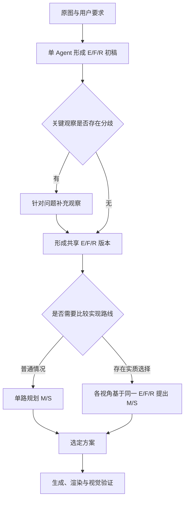

# 轻量 E/F/R、M/S 规划与多视角的接入顺序

- 日期: 2026-11-10.
- 状态: 讨论记录与后续设计建议. 本轮只记录方向, 不实施 M/S 或多视角, 不冻结新字段与工具接口.
- 目标: 在轻量观察基础上逐步跑通实现方案与生成验证, 保持通用性、可执行性和可控性.

2026-11-11 更新: 用户已进一步确认全图 S 范围、M 粒度、候选派生及 S 的主干/缺口/局部备选. 已确认决定与本轮语义细化集中在[轻量五库业务结构](five-library-planning-contract-20261111.md); 本文保留接入顺序, 不将这些设计写成已实现能力.

首版已按[单个全图规划 Agent 与生成交接实施方案](scene-planning-agent-plan-20261111.md)接通新合同、固定输入、草稿 harness 和整图生成。实现、校准与剩余语义问题集中在该记录。

## 1. 开发顺序与运行位置

建议开发顺序:

```text
稳定单 Agent 的 E/F/R 观察
  → 接入单路 M/S 规划
  → 跑通生成、渲染与视觉验证
  → 再验证并扩展多视角
```

运行时, 多视角的主要入口位于 E/F/R 初稿之后、实现方案最终确定之前. 开发顺序与运行位置是两件事: 先建立可靠的单路链路, 再在其中加入有明确收益的分支.

当前实现已能交付全图 E/F/R 观察包, 新观察包尚未接入 M/S 规划. 按草图生成入口会拒绝未规划的观察包, 旧完整五库包仍可使用既有生成路径. 现状见[当前架构](../architecture.md)与[生成输入校验](../../src/shader_deep/infrastructure/storage/generation_inputs.py).

## 2. 观察、机制与草图的职责

| 阶段 | 回答的问题 | 主要产物 |
| --- | --- | --- |
| E/F/R 观察 | 图中有什么, 哪些外观与配合需要保持? | 元素、特征、关系及必要上下文 |
| M 机制 | 这些视觉目标可以怎样实现? | 候选方法与内在适用条件 |
| S 草图 | 这一套方案选哪些方法, 怎样组合? | 目标到所选机制的对应及组织方式 |

M 是候选实现方法, 不宣称它就是原图的真实成因. S 是结构化实现构想, 不要求输出一张草图图片. 现有语义基线见[五库数据设计](../analysis-five-libraries.md).

建议保留独立的观察阶段, 后面新增一个规划阶段. 规划阶段由一个 Agent 在同一任务中组织 M 与 S, 不要求将两类产物拆成两个 Agent 或两次固定模型调用. 两个阶段分别管理输入、可用工具与提交合同.

以粉色圆形为例:

- E/F/R: 圆形、色场、亮带、柔影, 以及亮带沿轮廓展开的配合.
- M: 二维遮罩、渐变色场、弧状高光等候选方法; 也可能存在曲面着色路线.
- S: 选择一套路线, 说明各方法作用于哪些目标、怎样组合, 并共同满足轮廓与亮带的关系.

这些是阶段职责示例, 不规定其他图片的机制清单或方案数量.

## 3. 如何加入 M/S 而不加重 E/F/R

规划输入包括原图、用户要求、已发布的 E/F/R 版本, 以及实际生成环境的能力和限制. 规划引用观察对象, 不重新维护一套相同的观察正文.

规划侧需要表达三类信息:

| 信息 | 保存内容 | 边界 |
| --- | --- | --- |
| 机制正文 | 方法、必要输入与内在条件 | 不在通用方法正文绑定特定图片的对象 ID |
| 候选对应 | 哪些 F/R 可以使用哪些 M | 表达可选方法, 不代表已经采用 |
| 草图方案 | 实际采用的对应、组合方式和必要局部备选 | 一套方案能明确指导下游实现 |

后续讨论已确认候选关联主要由草图默认选择与局部备选派生, 模型只补充未被方案表达的必要候选. 完整字段与语义见[轻量五库业务结构](five-library-planning-contract-20261111.md). 可派生的反向索引与文件导航由程序维护, 跨图机制检索与长期知识库不作为首次接入的前置条件.

规划产物绑定明确的观察版本. 若规划发现观察错误, 先提出具体修订并形成新的观察版本, 再核对受影响的方案. 不在规划正文中悄悄改写同一 ID 的含义.

观察缺口与规划缺口分开记录. 某个 F/R 暂时没有可用实现方法, 不应倒推为该观察没有完成. 反过来, 关键观察仍不明确时, 也不能依靠编造实现方案掩盖缺口.

全图规划必须覆盖作用范围内的跨元素 R. 例如磨砂圆与底层彩色圆的交互, 不能各自规划完成后只做独立叠加. 后续讨论已确认首版所有 S 针对同一份完整 E/F/R, 由规划任务固定范围, S 不再重复填写 element_id 或 element_ids. 局部元素集合规划留到后续需求出现时设计.

## 4. 多视角放在哪里

本文的“多视角”指二维、空间、美学、物理等分析或实现思路, 不指输入多张相机视角图片.



这张图是建议的后续流程. 如果关键观察仍无法澄清, 应保留缺口或停止依赖该判断的规划; 箭头不表示任何输入都能自动得到完整方案.

### 观察补充入口

当重要对象、关系或可见事实存在分歧时, 在 E/F/R 初稿之后针对具体问题补充观察. 每次补充明确要解决什么, 不要求重新输出完整五库.

视觉材料不足时, 多个 Agent 重复看同一输入未必能解决问题. 是否需要更清晰的原图、局部回看或其他材料, 依据实际问题决定. 当前十图暴露的漏 R、重复归属和事实误读, 仍应先在单 Agent 基线上修正.

### 实现路线入口

当观察基本明确, 但基础表示、组成或组织方式存在实质选择时, 在 M/S 规划阶段展开多视角. 各视角共享同一原图、观察版本、用户要求与生成约束, 分别提出可比较的方案.

普通情况直接走单路. 不固定凑足几个视角, 不要求每个视角再写一遍 E/F/R. 不同路线作为候选保留, 不把互斥方法强行拼成一个草图. 只有局部方法存在差异时, 可按既有语义作为同一草图的局部备选.

路线比较考虑目标覆盖、可控性、实现成本与实际渲染效果. 视角数量、报告一致或多数票不能代替视觉验证. 在增加调度前, 明确每条路线的任务范围、调用预算和结束条件; 预算耗尽不等于质量通过.

## 5. 分阶段推进门槛

| 阶段 | 推进条件 | 不作为通过依据的信号 |
| --- | --- | --- |
| 稳定 E/F/R | 主要对象、关键关系和归属基本可靠; 真实缺口可识别并保留 | 仅结构合法、模型自称完成或条数与样例一致 |
| 单路 M/S 接入 | 作用范围内必要 F/R 有明确实现对应或真实缺口; 组合方式可执行 | 只列机制名称, 让生成 Agent 猜测作用对象 |
| 生成验证闭环 | 能依据选定方案生成与渲染; 失败可回溯到观察、规划或实现层 | 仅能编译、保存图片或提交自评 |
| 多视角扩展 | 在存在路线分歧或单路失败的任务中, 比较额外质量收益与时间/token 成本 | 多生成几份报告就认定效果提升 |

E/F/R 的推进条件不要求所有边缘细节都完美. 进入规划前, 应判断尚存问题是否影响关键实现决策. 多视角收益需要通过对照验证, 不默认成立.

## 6. 实施前仍需收口的问题

1. 将已确认字段与细化语义落实为新 M/S 提交合同和发布格式, 明确与已有完整五库读取、生成消费者的衔接.
2. 将已确认的全图范围落实为固定输入及覆盖校验, 保留跨元素 R; 首版不展开局部范围选择.
3. 观察版本变化后, 哪些规划需要重新核对, 如何保留原有产物.
4. 首版可执行性标准: 当前渲染能力、资源限制及必须交代的机制组织信息.
5. 多视角的触发条件、任务数量和预算边界, 以及方案比较与选择方式.

用户已认可当前 E/F/R 可用基线。单路 M/S 与生成已有首版实现，真实报告显示 M 自包含、gaps 判据及备选独立正文仍需校准。多视角调度继续依据后续实际路线分歧与验证收益设计。

## 7. 关联材料

- [轻量五库业务结构与规划语义](five-library-planning-contract-20261111.md).
- [单 Agent 观察实施记录](single-agent-observations-20261110.md).
- [十图综合审阅与优化建议](ten-case-observation-review-20261110.md).
- [当前架构](../architecture.md).
- [五库数据设计](../analysis-five-libraries.md): 用于核对 M/S 语义, 历史执行方式需对照当前源码.
