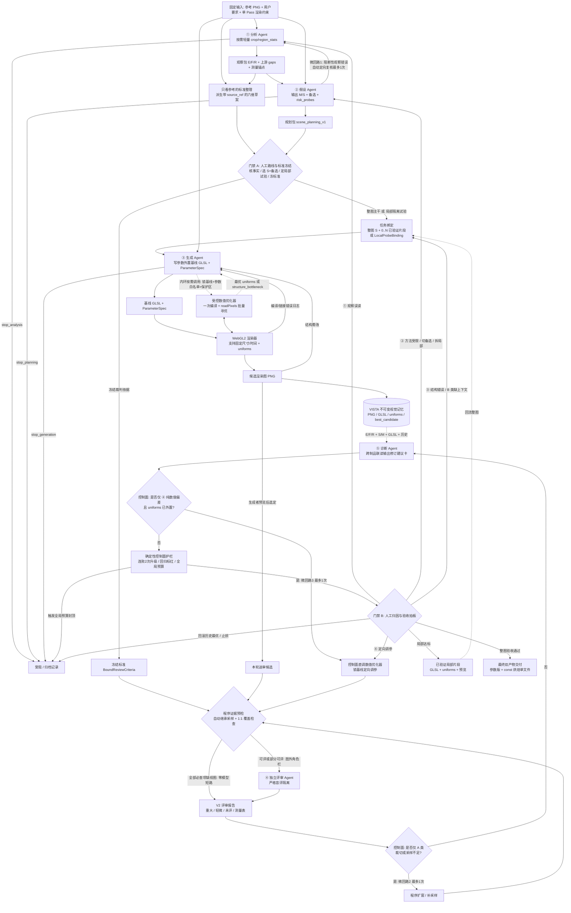

# PNG 转 Shader 整体流程优化设计方案

- 日期：2026-11-25。
- 状态：**四阶段实现已接入本地工作流，模型效果校准待完成**。下文保留设计定稿时的基线、职责与验收目标。当前实现与验证证据见[实施记录](workflow-optimization-implementation-20261125.md)。
- 评审基线：对照 [2026-11-20 交互流程图设计快照](../../../../.archify/workflow-png-shader-agents-artifacts-20261120-171119/agents-and-artifacts.html)、[项目进度与思路](../progress.md)、[轻量五库业务结构](five-library-planning-contract-20261111.md)、[独立视觉评审设计](independent-visual-review-design-20261117.md)、[评审实施与校准记录](independent-visual-review-implementation-20261117.md)与 [VISTA 最小图片记录设计](vista-minimal-image-records-design-20261113.md)。

---

## 1. 原流程（2026-11-20 快照）核心问题复盘

基于项目在十图观察、十图 M/S 规划、磨砂叠圆与新图配对评审中的真实运行证据，原设计快照存在以下 7 处关键缺口：

| 级别 | 问题 | 源码 / 实测依据 |
| :--- | :--- | :--- |
| **P0** | **主控归因缺上下文，且无防震荡与回归保护**：原图仅连入 `评审报告 → 主控`，但评审刻意盲评不看代码与方案，主控无跨制品材料无法区分“误读参考 / 方法受限 / 实现或参数问题”；同时缺乏连败升级与历史最优回滚机制 | [独立视觉评审设计](independent-visual-review-design-20261117.md#1-首版设计结论) |
| **P0** | **`局部机制 M` 直接进生成与五库契约冲突，缺选型门禁与固定输入连线**：`M` 是自包含通用方法，不含对象/坐标/背景；且参考 PNG 与单 Pass 渲染约束实际需持续注入规划与生成 | [轻量五库业务结构](five-library-planning-contract-20261111.md#3-m-的边界复用与依赖) |
| **P0** | **`调参 Agent` 闭环断裂，且参数注入契约悬空**：原图候选 PNG 只回连生成 Agent 未回连调参 Agent；当前 `WebGL2Renderer` 仅支持 `(glsl_code, width, height, time)`，且 VLM 裸眼对低对比连续数值极弱 | [renderer.py](../../src/shader_deep/rendering/renderer.py)、[磨砂叠圆盲评与亮度修订](independent-visual-review-implementation-20261117.md#14-磨砂叠圆特征盲评) |
| **P1** | **确定性测量与覆盖预检在流程中隐身，上游误读无早拦截**：磨砂叠圆分析误判明暗一路污染至生成与盲评；评审 V2 已实现覆盖预检与全缺图零模型短路，规划发现观察错误亦缺少直接回退通道 | [review_evidence.py](../../src/shader_deep/imaging/review_evidence.py)、[接入路线](observation-planning-multiview-roadmap-20261110.md#3-如何加入-ms-而不加重-efr) |
| **P1** | **`安排补采视图` 混淆两类 `inconclusive`**：原图把“仅裁切窗口偏小（可沿用同一 PNG 重裁）”与“缺背景上下文/缺时间帧（必须重渲染或换上下文）”混为一谈 | [评审指标准则](../visual-review-rubric.md#21-适用范围的规则) |
| **P1** | **局部达标候选缺少回流整图路径，且阶段早停通道漏画**：原图 `本轮保留的候选` 为死胡同，未表达局部片段如何汇入整图组合，也未画出编译错误回路与各阶段 `stop_*` 直达受阻记录 | [scene_generation.py](../../src/shader_deep/workflows/scene_generation.py)、[规划实测](scene-planning-agent-plan-20261111.md#132-真实校准) |
| **P2** | **现状基线与远期能力混画**：2026-11-24 独立评审 V2 按“供人复核的辅助工具”收尾，自动放行与自动停止尚未校准，原图未区分已落地能力与待建设计 | [评审收尾记录](independent-visual-review-implementation-20261117.md#24-2026-11-24-作为供人复核的辅助工具收尾) |

---

## 2. 已确认的 4 条宏观架构原则

1. **求解策略——整图主干优先 + 高风险机制按需局部隔离试验**：默认以整图骨架（布局、比例、遮挡、大色场、跨元素关系 `R`）为主线推进，保证上下文完整；仅在规划标出高不确定机制/路线分歧，或整图迭代中局部反复修不好时，按需下钻做局部隔离试验，验证后回流整图。
2. **调参定位——取消对话式调参 Agent，改用 `uniforms` 外置协议 + 像素测量驱动的受控数值优化器**：离散结构与算法交由生成 Agent，连续数值逼近交由确定性程序优化器在 WebGL2 上毫秒级寻优，用客观像素/边缘统计与保护区约束替代 VLM 裸眼猜数。
3. **主控拆解——明确分离“盲裁判”、“跨制品医生”与“确定性指挥官”**：独立评审保持盲评隔离；新增轻量 **⑤ 诊断 Agent** 负责跨制品认知归因；状态机、冻结、预算、升级、回滚与人机门禁全部由**确定性控制面**执行。
4. **自动化边界——执行内环自治 + 3 条低风险有界自动微回路 + 2 道显式人工门禁**：在固定评测集与自动放行阈值校准完成前，路线选择（门禁 A）与归因验收（门禁 B）坚持人工拍板；仅对低风险、可回退的 3 条有界微回路放开自动执行，减少无意义的机械人工往返。

---

## 3. 新版三层架构、角色定界与整体流转

### 3.1 认知层（5 个专精 Agent）

| 角色 | 核心职责 | 必须拿到的输入 | 必须隔离的内容 | 核心产出 | 设计时状态 |
| :--- | :--- | :--- | :--- | :--- | :--- |
| **① 分析 Agent** | 建立全链路共同目标坐标系 | 参考 PNG、用户要求、按需轻量像素探针（`crop`/`region_stats`） | 不预设 GLSL 实现技巧 | `E/F/R` + 上游 `gaps` + 可选 `reference_measurements` 锚点 | 基线已落地；轻量测量挂载待实施 |
| **② 假设 Agent** | 设计整图方案并标出高风险点 | 参考 PNG、`E/F/R`、单 Pass 渲染能力约束 | 不直接改写上游 `E/F/R`、不写最终代码 | `M/S` 规划包、局部备选、可选 `risk_probes`、`S.gaps` | 首版已落地；`risk_probes` 与早回退待实施 |
| **③ 生成 Agent** | 离散结构与算法实现、整合局部片段 | 参考 PNG、任务绑定、渲染约束、已验证局部片段、修订靶点、VISTA 按需回看 | 不替代独立裁判、不靠裸眼死磕微调浮点数 | 参数外置（`uniforms`）基线 GLSL + `ParameterSpec` + 选中送审候选 | 基线已落地；`uniforms` 声明与统一片段注入待实施 |
| **④ 独立评审 Agent** | 按冻结标准做盲评裁判 | 冻结双图（送模加图外角色栏）+ 冻结 V2 必查项 + 客观测量/覆盖证据 | **严格隔离** `E/F/R` 推演、`M/S`、GLSL、生成自评 | 带 `source_ref` 的 V2 差异清单、未评项与程序派生结论 | V2 基线已落地；`source_ref` 透传与图外角色栏待实施 |
| **⑤ 诊断 Agent** | 跨阶段归因与修订靶点建议 | V2 评审报告 + `E/F/R` + `S/M` + GLSL/`uniforms`/优化器信号 + VISTA 历史 | 不改代码、不改冻结标准、不越权放行 | 结构化「修订建议卡」（5 类归因 + 靶点 + 保护区清单） | 新增，待实施 |

### 3.2 确定性程序底座（Non-LLM Layer）

| 底座模块 | 核心职责 | 设计时状态 |
| :--- | :--- | :--- |
| **WebGL2 渲染与受控数值优化器** | 固定尺寸/时间 + `uniforms` 注入渲染；一次编译 + `readPixels` 毫秒级批量寻优；三层 Loss + 保护区硬约束；输出 `structure_bottleneck`；双形态交付（参数版 + `const` 烘焙单文件） | 单帧无参渲染已落地；`uniforms` 协议、批量评估与优化器待实施 |
| **标准整理与客观测量预检层** | 门禁 A 前只看参考整理带 `source_ref` 的六维标准草案；复用 `ReferenceMeasurements` 自动装配评审采样；1:1 覆盖预检与全缺图零模型短路 | 测量引擎与评审预检已落地；标准草案整理与上游锚点自动继承待实施 |
| **VISTA 不可变视觉记忆** | 统一保存参考 PNG、候选 PNG、基线 GLSL、`render.uniforms`、测量与评审记录，支持按记录回读与最优回滚 | 独立最小记录设计已确认；生产接入待实施 |
| **确定性控制面（指挥官）** | 状态机、输入/标准冻结、3 条有界自动微回路、版本最小级联、全局 3–5 大轮预算封顶、连败 2 次升级建议、`best_candidate` 与回归标红、门禁 A/B 审批 | 各阶段独立运行控制已落地；跨阶段控制面待实施 |

### 3.3 整体流程拓扑（两道人工门禁 + 三条有界自动微回路）

---

## 4. 专题 1：上游闭环（① 分析 ↔ ② 规划 ↔ 门禁 A）

### 4.1 分析阶段挂载轻量只读测量工具
- **工具复用**：复用既有 [ReferenceMeasurements](../../src/shader_deep/imaging/measurements.py)，为 ① 分析 Agent 挂载受限只读工具，仅开放 `crop` 与 `region_stats`，预算严格封顶（建议单次分析最多 4–6 次独立操作，同规格自动缓存去重）。
- **触发约束**：写入 `scene-observer/SKILL.md`，仅在易产生裸眼误读的场景按需调用——低对比明暗方向、细小结构/开口确认、渐变主色锚点；不强制每条特征都测。
- **契约保持轻量化**：`scene_observations_v1` 核心 `E/F/R` 字段保持不变，不恢复旧五库强绑定证据 ID 的重型结构；本次触发过的合法测量记录作为可选附属字段 `reference_measurements` 随观察包保存，供下游评审与数值优化器直接复用经越界校验的真实像素区域。

### 4.2 门禁 A 前的轻量标准整理与冻结
- **只看参考准备步骤**：在观察接受后、进入门禁 A 前，执行一次轻量整理步骤，仅接收**参考 PNG + `E/F/R` + `context_notes` + 用户要求**（绝不接触任何候选图或代码），输出整图 `scene` 模板下的六维 `BoundReviewCriteria` 草案。
- **跨阶段追溯锚点**：每条 `required_check` 携带 `source_ref`（指向具体 `E/F/R` ID 或 `user_requirement`），使下游评审报错能精确映射回上游观察与规划方法。
- **冻结时机**：在**门禁 A** 经人工审阅微调后冻结，形成不可变的 `BoundReviewCriteria`（含 `criteria_sha256`）。

### 4.3 规划 → 分析的结构化早回退（微回路 1）
- **职责不越界**：规划 Agent 绝不私自修改 `E/F/R`。非阻断小缺口保留在 `partial` 规划中交门禁 A；遇到阻断性事实矛盾或关键对象/关系遗漏时，调用 `stop_planning` 并提交结构化 `observation_revision_request`（争议 `E/F/R` ID、对照原图发现的矛盾、建议核实区域）。
- **自动定向复核与防扯皮护栏**：控制面自动触发最多 **1 次**定向复核版 ① 分析——将 `E/F/R v1` 作为只读参考底稿 + 争议说明送入，要求分析 Agent 用轻量测量/裁剪核实并输出不可变的 `E/F/R v2`（尽量保留无争议条目的原 ID），随后自动重跑规划。若 `v2` 后规划仍报错，停止自动回退，直接升交门禁 A 人工裁定。

### 4.4 门禁 A 最小决策包
门禁 A 在一页摘要内一次性拍板 4 件事：
1. 核对 `E/F/R` 摘要、关键测量锚点与上游 `gaps`；
2. 从规划包中选定 1 套整图主干 `S`（及至多 1 项局部备选 `alternative`）；
3. 审阅 `S.risk_probes`，决定直接进整图生成，还是先对 1–2 个高风险点做局部隔离试验；
4. 确认并冻结本轮评审标准草案。

---

## 5. 专题 2：求解策略落地（整图主干 vs 高风险局部隔离试验）

### 5.1 两类按需触发条件
- **事前触发**：在 `PlanningSketch`（[scene_planning.py](../../src/shader_deep/domain/scene_planning.py)）增加可选轻字段 `risk_probes`（每项声明目标 `target_ids`、高风险原因及建议上下文模式）。普通图留空；复杂图由 ② 假设 Agent 标出，门禁 A 拍板是否试跑。
- **事中触发**：整图评审后，若某局部缺陷在整图里反复修不好或修改引发严重回归，由门禁 B 决定抽离做专项隔离试验。

### 5.2 `LocalProbeBinding` 与 3 种显式试验上下文
保持 `M` 自包含不绑具体对象与坐标；局部试验通过独立的 `LocalProbeBinding` 固定 5 要素：
1. **来源与目标**：规划身份 `S`（及可选备选）、目标 `F/R`（或单个 `E`）及对应 `M` 组合；
2. **显式上下文模式**：
   - `isolated_solid`：纯色/中性底画布（轮廓、几何 SDF、独立渐变/纹理/发光体）；
   - `proxy_context`：极简代理底层/相邻物（依赖底层色彩或邻域的磨砂透显、投影融合）；
   - `scene_baseline_patch`：锁定当前整图基线 GLSL 的其余部分，在真实整图上下文中仅替换/重测该局部逻辑（事中专项攻关首选）；
3. **画布与坐标约定**：保留与原图可比的坐标关系；
4. **局部冻结标准**：程序按 `source_ref` 从门禁 A 冻结的整图标准中切出对应必查项，其余维度显式排入 `excluded_checks`，复用现有 `scope=local, target_kind=feature|element` 评审模板；
5. **小预算封顶**：快进快出验证可行性，不在局部阶段耗尽全局预算。

### 5.3 回流机制与入口统一
- **达标回流**：局部试验通过后沉淀为**「已验证局部片段（Verified Snippet）」**（局部 GLSL + 实测最优 `uniforms` + 预览 PNG + 局部评审记录），作为固定参考素材注入整图生成（若为 `scene_baseline_patch` 则可直接晋升为新整图基线）。
- **证伪止损**：局部试验失败或受阻时，有 `alternative` 则切备选验证，无备选则携带证伪记录退回 ② 假设 Agent 换方案，避免整图白跑。
- **收编已有入口**：
  - 统一整图生成入口（`run_generation_from_planning`）原生支持接收 **`0~N` 个已验证局部片段**，收编原 `run_scene_generation` 的两元素组合能力；
  - 现有 `run_generation_comparison` 收编为高风险点 `default` vs `alternative`（或 `S1` vs `S2`）在同上下文、同标准下的**平行对照模式**。

---

## 6. 专题 3：执行内环核心（`uniforms` 外置协议 + 受控数值优化器）

### 6.1 参数外置声明与双形态交付
- **结构与数值分离**：③ 生成 Agent 将连续数值外置为 GLSL `uniform`，提交渲染时附带可选 `ParameterSpec` 列表：
  - `name`（禁止与内置 `iResolution`、`iTime` 冲突）；
  - `type`（首版支持 `float` / `vec2` / `vec3` / `vec4`）；
  - `default`（首帧基线初值）；
  - `min` / `max`（各分量程序硬边界）；
  - `target_ref`（可选，关联 `E/F/R` ID，支持局部修订时仅放开相关参数）。
- **兼容与记忆对齐**：未声明 `uniforms` 时完全兼容现有无参 GLSL；运行期按 [VISTA 最小图片记录设计](vista-minimal-image-records-design-20261113.md#d-外部渲染参数) 共用稳定基线 `shader.glsl`，每条记录保存本次生效的 `render.uniforms` 与对应 PNG。
- **双形态最终交付**：最终验收交付同时保存两份资产——**参数化主资产（基线 GLSL + 最优 `uniforms` JSON）**与**确定性烘焙单文件（程序将 `uniform T u_x;` 替换为 `const T u_x = ...;` 的零外部依赖 ShaderToy GLSL）**。

### 6.2 WebGL2 渲染器两项克制扩展
保持 `rendering/` 独立无框架依赖：
1. **常规单帧渲染**：`WebGL2Renderer.render(glsl_code, width, height, time, *, uniforms=None)`（keyword-only，保持公开签名兼容），链接后经 `gl.getActiveUniform` 校验参数存在性与类型匹配。
2. **优化专用会话（一次编译、毫秒级批量评估）**：单次优化会话内只编译链接 1 次 `WebGLProgram`；寻优迭代过程仅更新 `uniforms`、绘制并用 `gl.readPixels` 读取目标区域/下采样像素缓冲计算误差，不走全图 `toDataURL` PNG 编码；仅对起点基线、胜出参数组及关键拐点导出完整无损 PNG 落盘并登记为正式候选。

### 6.3 受控数值优化器与双入口协作
- **三层可组合误差函数**：
  1. **锚点统计误差**：对齐参考与候选在指定采样区的 `mean_rgb`、`mean_luma` 及区域间相对亮度/色彩差；
  2. **ROI 像素 + 边缘梯度误差**：在指定区域（或全图下采样）计算色彩 L1 与 Sobel 边缘梯度差，兼顾位置、尺度、色场与软硬边；
  3. **保护区回归硬约束**：已达标保护区漂移超过容差时直接拒收或施加高额惩罚。
- **确定性黑盒搜索策略**：采用固定随机种子的无梯度黑盒优化（不引入可微渲染重依赖）——低维（1–8 标量分量）采用 Powell / Nelder-Mead / 自适应坐标搜索；中高维耦合（8–20 分量）采用小范围拉丁超立方探测 + CMA-ES。单次放开维度设上限，鼓励按 `target_ref` 分组优化。
- **反向信号 `structure_bottleneck`**：优化器绝不改写 GLSL。跑满评估预算仍无有效下降或无法在不破坏保护区的前提下收敛时，显式返回 `structure_bottleneck`（附起点/终点误差及触边参数），作为“需改代码结构或换方法”的客观证据。
- **双入口调用**：
  1. **执行内环工具入口**：开放受限工具 `optimize_uniforms` 给 ③ 生成 Agent，结构编译成型后按需调用，胜出候选渲染正式 PNG 并在下一轮注入预览供生成 Agent 回看确认（保持“预览入模才允许 `finish_shader`”红线）；
  2. **控制面定向入口**：当评审与诊断确认为「④ 纯数值偏差」时，控制面可锁死基线 GLSL 直接发起定向优化，无需重跑生成 LLM。

---

## 7. 专题 4：独立评审与证据补采闭环

### 7.1 默认 V2 协议与冻结权限
- 新整体流程默认启用 **`visual_review_v2`**，每条必查项携带稳定 `check_id` 与上游 `source_ref`；V1 仅保留给既有独立入口兼容。
- 延续 V2 既有防线：程序锁定缺图项、已答保护、带理由单项重评、零模型恢复发布与三联交付摘要（重大问题、轻微问题数、待补证项）。
- 权限红线：整图标准在门禁 A 冻结，局部标准由程序按 `source_ref` 派生；生成角色无权删减或放宽必查项。

### 7.2 证据自动装配与视觉身份防混淆
- **自动继承采样点**：自动复用专题 1 的 `reference_measurements` 锚点及专题 3 优化器的目标/保护区采样框，在 1:1 画布映射下由 [review_evidence.py](../../src/shader_deep/imaging/review_evidence.py) 复算成对像素统计，随双图送入评审 Agent。
- **1:1 覆盖预检与短路**：局部/裁图评审前先核对必查矩形——全部必查项缺视图时零模型短路交付 `inconclusive`；部分缺视图时程序锁定缺图项，模型只审窗口内可见项。
- **图外角色栏**：测量与哈希校验始终使用原始无损 PNG 字节；送入评审 VLM 的派生展示视图在有效图像外增加清晰角色栏（参考 / 候选），减少左右角色混淆风险（落地后需经同图与角色互换小样本对照验证）。

### 7.3 两类 `inconclusive` 分流（含微回路 2）
| 类型 | 根因 | 处置路径 | 护栏 |
| :--- | :--- | :--- | :--- |
| **A 类：视图采集不足**（`insufficient_crop_or_sample`） | 候选整图已有信息，仅裁剪窗口太小或缺像素采样 | **微回路 2（自动）**：控制面沿用同一候选 PNG，程序扩窗（直至整图）或补采样后直接复评 | 同一候选最多自动补采复评 **1 次**；仍无法判断则交门禁 B |
| **B 类：上下文或时间帧缺失**（`missing_context_or_frame`） | 现有 PNG 物理上不含可比信息（如孤立黑底缺背景、静态帧缺动态） | 回流渲染层（同 GLSL + `uniforms` 换 `t` 重渲染）或任务绑定层（切 `proxy_context` / 整图上下文） | 需经门禁 B 确认路线，产生新候选 |

---

## 8. 专题 5：跨制品诊断归因、确定性控制面与门禁 B

### 8.1 ⑤ 跨制品诊断 Agent（单次只读认知层）
- **固定输入包（5 份只读材料）**：本轮 V2 评审报告（含测量表与 `source_ref`）、上游 `E/F/R` 及测量锚点、当前生效 `S/M` 及两类 `gaps` 与可用备选、当前基线 GLSL + `ParameterSpec` + `uniforms` + 优化器状态（含 `structure_bottleneck`）、VISTA 历史尝试与 `best_candidate` 摘要。
- **5 类标准归因路由**：
  1. **① 观察误读（`observation_error`）**：评审观测/像素实测与 `E/F/R` 描述直接冲突 → 返回 ① 分析定向复核；
  2. **② 方法受限（`planning_limit`）**：命中规划 `gaps`、单 Pass 边界、局部证伪或连败升级 → 返回 ② 假设切备选/换 `S`/拆局部试验；
  3. **③ 结构/公式错误（`code_structure`）**：未落实 `M/S`、对象缺失/遮挡错误或优化器报 `structure_bottleneck` → 返回 ③ 生成改结构；
  4. **④ 纯数值偏差（`numeric_tuning`）**：结构算法正确，仅连续量偏离且对应 `uniforms` 已外置 → 直达受控数值优化器；
  5. **⑤ 条件/上下文缺失（`evidence_gap`）**：B 类 `inconclusive` → 换帧重渲染或补上下文。
- **标准产出**：结构化「修订建议卡（Revision Proposal）」，包含逐条重大问题的归因与证据链、下一轮修订靶点、以及从已 `match` 维度派生的**保护区清单**。

### 8.2 微回路 3：纯数值偏差自动定向优化
- 当 ⑤ 诊断 Agent 确认本轮重大问题**全部属于「④ 纯数值偏差」**、且对应 `uniforms` 均已外置在参数白名单内时，控制面可**自动锁死基线 GLSL 触发 1 次定向 `optimize_uniforms` + 复评**（零代码改动风险），再将更新后的候选、复评结果与诊断卡一并呈交门禁 B。
- 若优化器返回 `structure_bottleneck`、保护区回归或复评未消除重大问题，不再自动重试，立即进入门禁 B 并附带升级提示。

### 8.3 确定性控制面 5 条硬护栏
1. **连败升级建议**：同一 `source_ref` 的同一重大问题，纯数值优化连败 2 次（或报 `structure_bottleneck`）→ 自动升级建议为「③ 结构修改」；结构修改连败 2 轮 → 自动升级建议为「② 方法受限」。
2. **历史最优与回归保护**：控制面在 VISTA 账本维护 `best_candidate`（按“重大问题更少 → 保护区零回归 → 目标误差更小”排序，人工标注优先）；新候选破坏原 `match` 保护区时强制标红回归项，支持一键回滚分叉。
3. **版本最小级联**：退回 ① 分析产出 `E/F/R v2` 时，仅将受变更 ID 影响的规划与评审项标为需更新，保留无关的已验证局部片段。
4. **双层预算封顶**：保留各阶段单次预算，新增**全局大轮次上限（默认 3–5 轮）**与全局成本上限；触顶强制归档 `best_candidate` 与剩余问题至受阻记录。
5. **验收权分离**：`no_major_issue_observed` 不自动等同用户验收；局部通过回流整图，整图通过仍须经门禁 B 由人确认交付。

### 8.4 门禁 B 最小决策面板
- **展示 4 块高密度信息**：参考 vs 本轮候选（可切 `best_candidate`）及像素测量差；V2 评审摘要与标红回归项；⑤ 诊断建议卡与连败升级提示；剩余全局预算。
- **5 选 1 人工动作**：**接受/晋升**（局部回流整图 / 整图验收交付双产物）、**采纳推荐修订**、**人工改派路由**、**回滚 `best_candidate` 分叉**、**止损归档**。

---

## 9. 分阶段实施路线与自动化解锁门槛

遵循应用“最小改动先验证高价值闭环、不提前堆砌通用抽象”的原则，建议按 4 个独立阶段推进：

| 阶段 | 实施内容 | 核心验证与收口标准 |
| :--- | :--- | :--- |
| **Phase 1：执行内环数值能力（最高杠杆）** | 1. 落地 `WebGL2Renderer` 的 `uniforms` 注入、`getActiveUniform` 校验与一次编译 `readPixels` 批量评估； 2. 实现受控数值优化器（三层 Loss、保护区硬约束、无梯度黑盒搜索、`structure_bottleneck`、双形态烘焙导出）； 3. 开放 `optimize_uniforms` 给 ③ 生成 Agent，并对齐 `vista-memory` 记录格式 | 无网络单测 + 真实 WebGL2 集成测试；用磨砂叠圆与发光图实测对比“纯生成 vs 生成+数值优化器”的像素误差、耗时与 token 成本 |
| **Phase 2：上游契约补齐与局部回流** | 1. ① 分析 Agent 挂载轻量 `crop`/`region_stats` 工具并保存 `reference_measurements`； 2. 门禁 A 前只看参考的标准整理（输出带 `source_ref` 的 V2 草案）； 3. `PlanningSketch` 增加可选 `risk_probes`，落地 `observation_revision_request` 与 `LocalProbeBinding`（3 种上下文），统一整图入口支持 `0~N` 已验证局部片段 | 离线契约与回归测试；实测磨砂叠圆分析不再判反明暗；验证局部隔离试验结果可回流整图生成 |
| **Phase 3：评审自动装配与 ⑤ 诊断层** | 1. 评审 V2 默认启用 `source_ref` 透传、自动继承上游测量锚点、图外角色栏视图； 2. 实现 ⑤ 诊断 Agent（5 份跨制品输入、5 类归因、保护区清单） | 同图与角色互换对照验证图外角色栏；用历史失败与成功运行包做离线诊断归因人工复核 |
| **Phase 4：确定性控制面与门禁 A/B 接线** | 1. 实现跨阶段控制面状态机、3 条有界自动微回路（各上限 1 次）、5 条硬护栏（连败升级、`best_candidate`、回归标红、最小级联、全局 3–5 大轮预算）； 2. 在 CLI 与本地网页接入精简的门禁 A / 门禁 B 交互面板 | 端到端受控多轮回归（含人工回滚、连败升级、预算封顶路径）；保留全链路 VISTA 与追踪记录 |

**远期自动化解锁条件**：待独立评测样本集建成，且在真实候选上完成评审 V2 的重大问题召回率、错误放行率、误拒率以及 ⑤ 诊断层归因准确率的量化校准后，再评估逐步放开整图自动放行与跨轮全自动调度。
